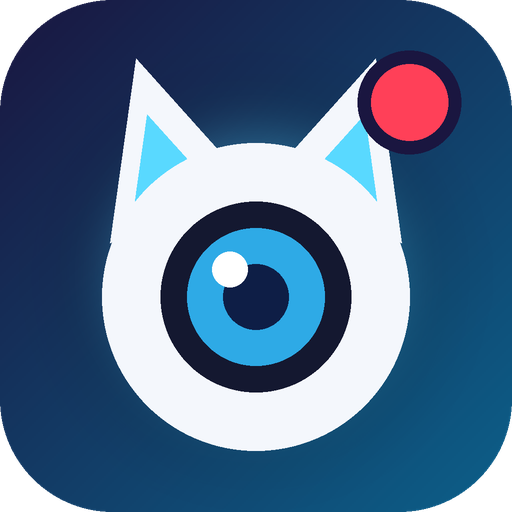

# AvatarCam – VRChat avatar virtual camera for OBS

**English** | [Magyar](README.hu.md)

A Windows program (Dear ImGui + Direct3D 11) that turns your VRChat avatar – or any VRM / FBX / GLB model – into a
camera image for OBS, Discord, or anywhere OBS's Virtual Camera works. Face and hand tracking from a webcam, lip sync
from a microphone, and VMC input are built in.

The interface is English by default. To switch to Hungarian: **Output → Program → Language / Nyelv**.

## Download and start

From the [Releases](../../releases) page, download either:

- **`AvatarCam-<version>-setup.exe`** – installer (no admin rights needed): Start menu and desktop shortcuts, uninstaller.
  Installing a newer version over the old one keeps your settings and avatars.
- **`AvatarCam-<version>-win64.zip`** – portable version: unpack it anywhere and run `AvatarCam.exe`.

The `onnxruntime*.dll` files and the `models` folder next to the exe are needed for face and hand tracking.
Settings, imported avatars and presets are stored next to the exe.

**Updates:** at startup AvatarCam checks GitHub for a newer version. If there is one, it shows what's new and lets you
update now or later: *Update now* downloads the installer, verifies its checksum, installs it into the program's folder
and restarts AvatarCam – your settings and avatars are kept. Turn it off under Output → Program → *Check for updates at startup*.

Everything runs locally: the webcam and microphone are only processed on your computer, nothing is sent anywhere.
The only network access is the update check on GitHub, which can be turned off.

## Importing an avatar

**Avatar → Import…**, or just drag the file into the window.

| Format | What is imported |
|---|---|
| VRChat `.unitypackage` | model, materials (Poiyomi / lilToon / Standard / MToon approximation), textures, **the full VRChat menu** (outfit and accessory toggles, color sliders), FX animator, blinking, lip sync (visemes), eye bones, **PhysBone / DynamicBone physics** |
| `.vrm` (0.x and 1.0) | model, MToon, expressions (happy, angry…), spring bones, node constraints |
| `.glb` / `.gltf` / `.fbx` | model and materials, bones recognized by name |
| `.zip` | imports the best model inside |

Adult add-on systems (DPS/TPS/SPS) are skipped by the importer.

## Tabs

- **Avatar** – avatar list, hand gestures (left/right), VRM expressions, **your VRChat menu** (Clothing, Accs, Colour Options…), all parameters.
- **Body parts** – toggle every body part / clothing item (right-click: back to the avatar's state), per-material
  tint, hue, saturation, brightness, custom emission color, emission strength, opacity; global hue shift; blendshapes.
- **Scene** – background (transparent, solid color, gradient, image, chroma key), **virtual lights** (directional / point / spot, color,
  intensity, direction, shadows, follow camera; presets: Studio, Neon, Sunset, Dramatic, Flat), camera, look:
  toon / PBR / flat shading, rim light, outline, glow (bloom), tone mapping, shadows, ground shadow.
- **Motion** – posture (arms, elbows, wrists, fingers), breathing, sway, head motion, auto blink (with an adjustable interval range,
  e.g. every 3–6 seconds, and optional double blinks), eye movement, physics.
- **Tracking** – webcam face tracking (head, blinking, mouth, smile, eyebrows, eyes), **hand tracking** (arms, wrists, fingers),
  lip sync from a microphone, VMC receiver.
- **Output** – resolution, FPS, **background** (same as on the Scene tab), OBS connection, Spout2, **performance**, presets,
  **global hotkeys** (they work while gaming too), UI scale, language.

In the preview: left mouse = orbit, right/middle = pan, wheel = zoom, double-click = default view.

Any value can be typed in: **double-click** a slider (or Ctrl+click), type the number and press Enter. Right-click resets a slider to its default.

## OBS setup

**A) Game Capture (recommended, no plugin needed)**
1. Output tab → turn on *Output window* (or the checkbox above the preview).
2. OBS: Sources → + → *Game Capture*.
3. Mode: *Capture specific window*, Window: `[AvatarCam.exe]: AvatarCam Output`.
4. Check **Allow Transparency** and uncheck **Capture Cursor**.

The output window keeps delivering frames even when you alt+tab away or the game is in front of it. It can't be minimized
(if it is, e.g. with Win+D, it restores itself) and it has no mouse cursor. Drag it with the mouse; right-click closes it.

While the output window is on, the main window doesn't show the avatar (the image is only in the output window);
you can still orbit, pan and zoom the camera there with the mouse.

Don't capture the main AvatarCam window: it shows the UI too, gives no image while minimized, and the mouse can appear on it.

**B) Spout2** – the fastest connection with full transparency; OBS needs the *Spout2 Plugin for OBS*.
Output tab → *Send via Spout2*, OBS source: *Spout2 Capture* → `AvatarCam`.

**C) Chroma key** – Scene → Background: *Chroma key*, then window capture in OBS + a *Chroma Key* filter.

If you start OBS's **Virtual Camera**, the avatar becomes a camera image in Discord, Zoom, etc.

## Using it while gaming (performance)

The Output → *Performance* section shows how much CPU and GPU the program uses.

- If OBS streams at 30 fps, set the *FPS limit* to 30 (or press **Power saving**): this halves the rendering load.
- When the AvatarCam window is not in the foreground, the UI refreshes rarely (*UI FPS in background*); the image going to OBS stays at full speed.
- If the avatar only fills a corner of the stream, 1280×720 is plenty.
- Tracking (face, hands) runs at below-normal priority, so the game gets priority.
- Capping the game's FPS leaves GPU headroom for OBS and the avatar.

## Tracking tips

- Good, frontal lighting, with the camera at roughly eye level.
- Look straight into the camera and press **Recenter**.
- Blink and mouth detection calibrate themselves during the first 10–20 seconds.
- For phone tracking (e.g. Waidayo), use the VMC receiver (default port: 39539).
- Microphone lip sync: if the mouth barely moves, raise the **Gain** (up to 50x) or turn on **Automatic gain**, which adapts to your voice
  and keeps the mouth closed on background noise. *Mouth opening* sets how wide it opens; on the level meter the white line
  is the noise gate – your voice should go well past it.
- For hand tracking, keep your hands in the camera's view and well lit. When a hand leaves the image, the arm
  smoothly returns to its rest pose. *Show camera image* shows what the program detects.
- Hand mirroring can be set separately (Tracking → Hand tracking → *Mirror*): on, your right hand moves the avatar's left hand
  (like a mirror); off, it moves the right one. If the hands move the wrong way, toggle this.

## Building from source

Requirements: Visual Studio 2022/2026 C++ tools, CMake, Ninja.

```bat
git clone --recursive https://github.com/FrankHUN88453/AvatarCam.git
cd AvatarCam
build.bat
```

The result is `bin\AvatarCam.exe`. For tracking, copy `onnxruntime.dll`, `onnxruntime_providers_shared.dll` and the
`models` folder from the release zip into `bin\`.

Command-line helpers: `AvatarCam.exe --import <file>` (import without a window),
`AvatarCam.exe --screenshot <image.png> <seconds>` (save the output image, for testing).

## Known limitations

- Poiyomi / lilToon shaders are approximated (color, texture, normal map, emission, masks, matcap layers, hue shift).
  Poiyomi's built-in matcap textures (not included in avatar packages) are replaced with a generic metallic shine –
  Scene → Look and effects → *Missing Poiyomi matcap fallback* (Dark metal / Chrome / Skip).
- Particle systems (e.g. breath smoke) and Unity constraints (e.g. sword systems) are not shown / not simulated.

## Third-party components

Dear ImGui (MIT), ufbx (MIT / public domain), cgltf (MIT), stb (MIT / public domain), nlohmann/json (MIT),
ONNX Runtime (MIT), OpenSeeFace models (BSD 2-Clause), MediaPipe hand models – OpenCV Model Zoo (Apache 2.0),
Spout2 SDK (BSD 2-Clause). License texts: `bin\licenses` (in the release zip: `licenses`).

## License

AvatarCam is released under the [MIT License](LICENSE). Third-party components keep their own licenses (see above).
